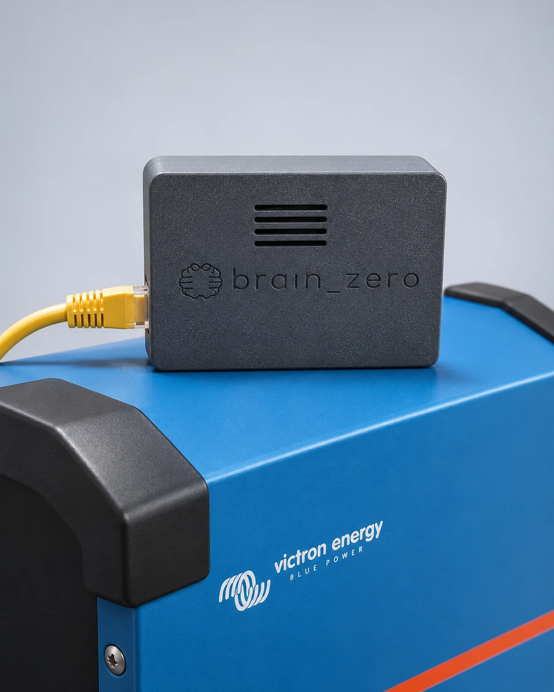
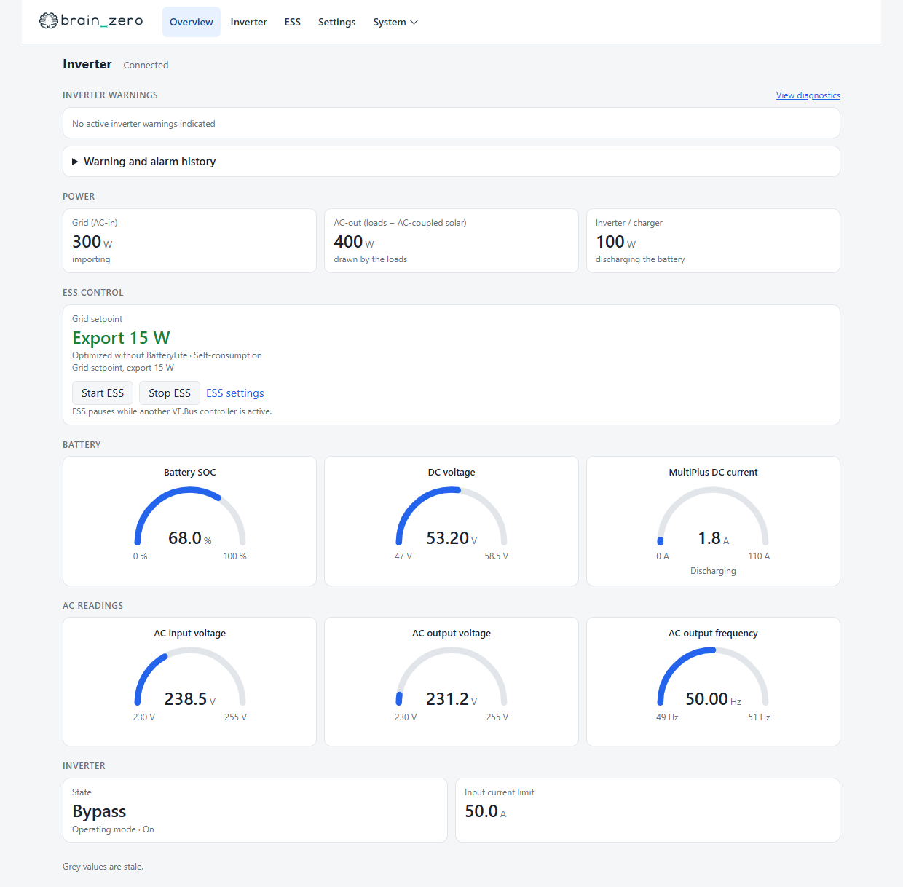
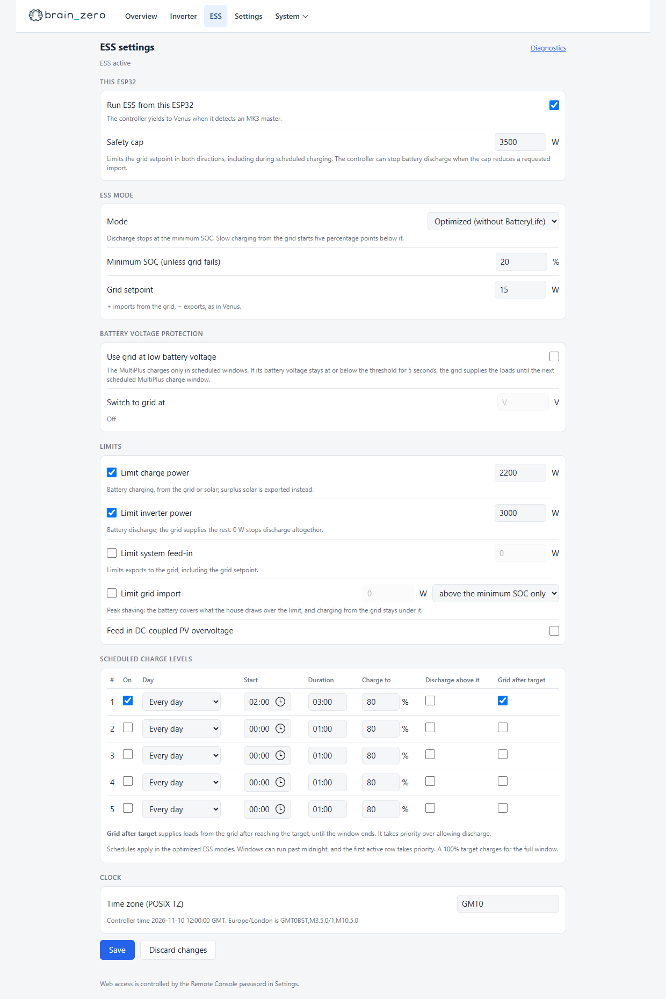
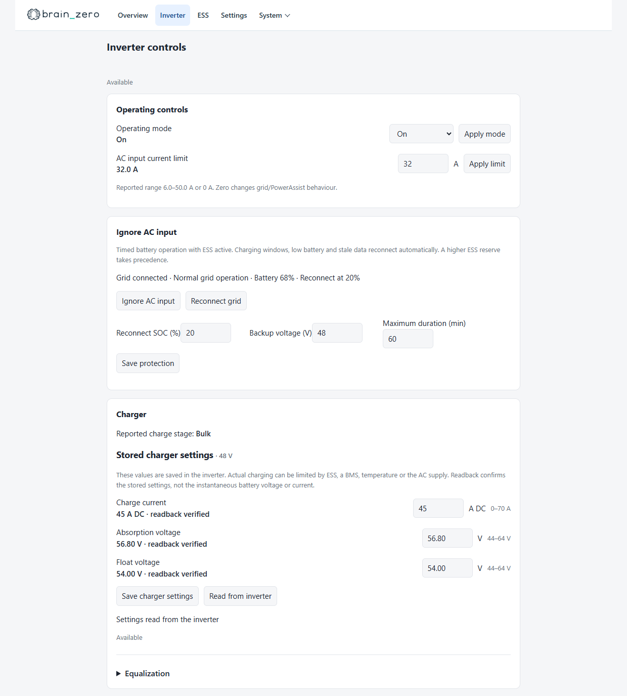
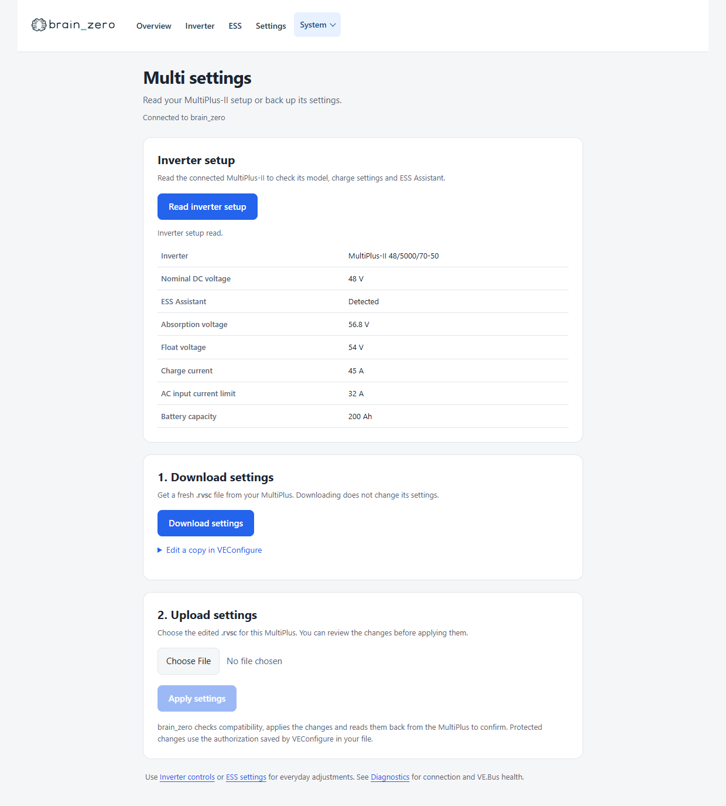
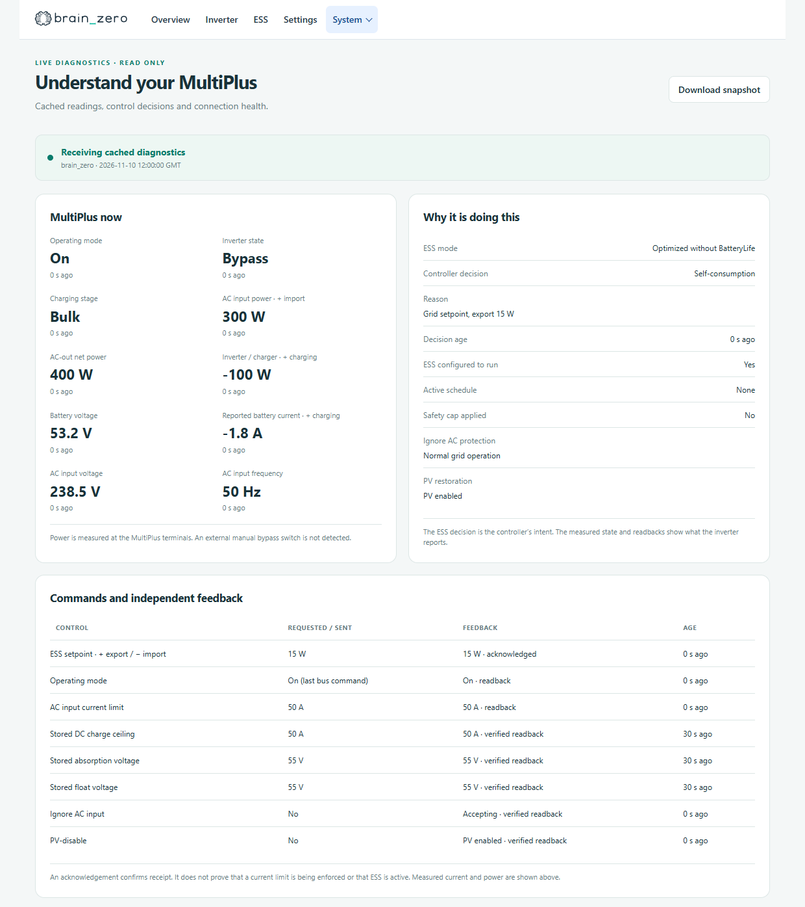
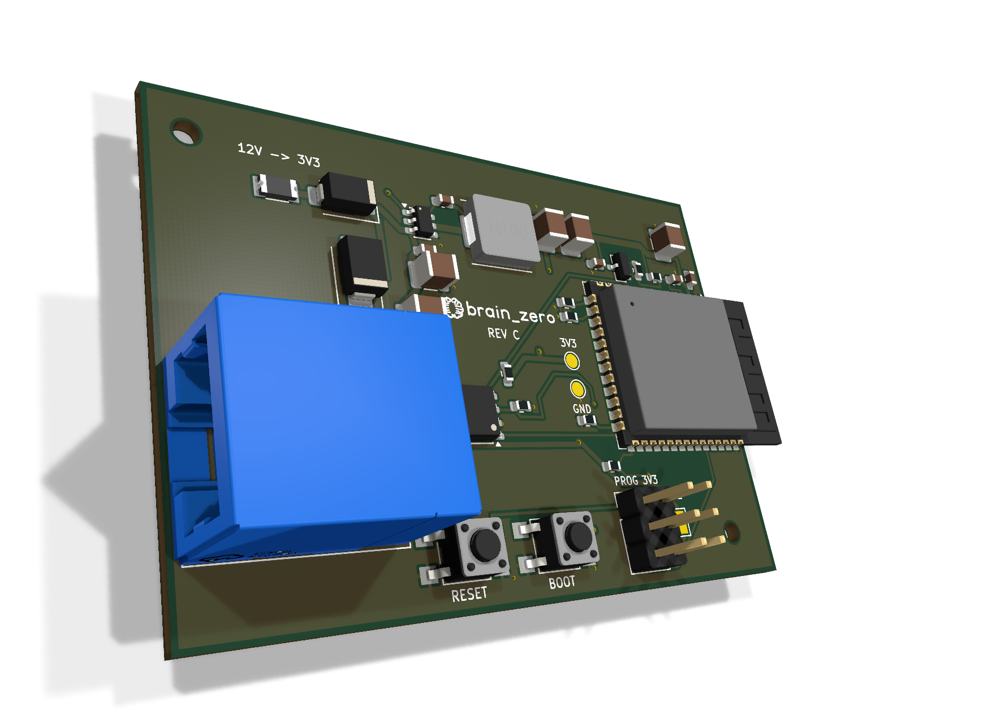

# brain_zero

brain_zero is a Wi-Fi dongle for Victron MultiPlus-II inverter/chargers. It plugs into the inverter’s VE.Bus port and gives you a local dashboard. On supported firmware, it can also control ESS and read or write stored inverter settings.



## Software

The [brain_zero firmware source](firmware/vebus_listener) lives in this repository. [GitHub Releases](https://github.com/mjpalmowski/brain_zero/releases) provide only the OTA `firmware.bin` for brain_zero devices. For other hardware, [compile the software from this repository](firmware/vebus_listener#build) with the board and pin configuration for your hardware. Android and iOS apps are in development.

All brain_zero devices use the same firmware. Optional external-battery SOC and voltage, plus external charging-current measurements, can be supplied over MQTT and configured at runtime. [Home Assistant](home-assistant/custom_components/brain_zero) owns installation-specific overnight and free-power plans and coordinates external chargers. Its optional adapter imports existing plans and preserves entity IDs when migrating from earlier firmware.

The screenshots show the local web interface with example data. Select a screenshot to open it full size.

**Dashboard** · Battery state of charge and live AC and DC measurements.

[](images/dashboard.png)

| ESS settings | Inverter controls |
| --- | --- |
| Grid setpoint, charge and discharge limits, and scheduled charge levels. | Operating mode, AC input current limit, and feedback from VE.Bus. |
| [](images/ess.png) | [](images/inverter.png) |

| Inverter settings | Diagnostics |
| --- | --- |
| Read the inverter setup and download or upload a VEConfigure settings file. | See live measurements, ESS decisions, and connection health. |
| [](images/multi-settings.png) | [](images/diagnostics.png) |

## MultiPlus-II compatibility

These profiles are for standalone 230 V units. Check the full seven-digit VE.Bus firmware number in Diagnostics or Victron’s tools.

| Model | Firmware | Test coverage |
| --- | --- | --- |
| MultiPlus-II 48/5000/70-50 | `2623563` | ESS verified on physical hardware. Stored inverter settings writes supported. |
| MultiPlus-II 48/5000/70-50 | `2623556` | ESS tested in replay. |
| MultiPlus-II 48/3000/35-32 | `2629556` | ESS and stored inverter settings writes tested in simulation. |
| MultiPlus-II 24/3000/70-32 | `2611552` | ESS and stored inverter settings writes tested in simulation. |
| MultiPlus-II 48/4k5/55-32 | `2601560` | ESS and stored inverter settings writes tested in simulation. |

### Firmware we’d like to support

We’re collecting settings profiles for the revisions below. All ten passed monitoring checks in the Venus Pi simulator. ESS and settings writes need further testing with matching exports. If your model or firmware is missing, [send us a compatibility profile](#share-a-compatibility-profile).

| Model | Firmware wanted |
| --- | --- |
| **MultiPlus-II 24/3000/70-32** | **`2611556`** |
| **MultiPlus-II 48/4k5/55-32** | **`2601570`** |
| MultiPlus-II 48/5000/70-50 | `2623570` |
| MultiPlus-II 48/6k5/100-50 | `2602570` |
| MultiPlus-II 48/3000/35-32 | `2629570` |
| MultiPlus-II 48/8000/110-100 | `2621570` |
| MultiPlus-II 12/3000/120-32 | `2605558` |
| MultiPlus-II 48/10000/140-100 | `2627570` |
| MultiPlus-II 24/5000/120-50 | `2615559` |
| MultiPlus-II 48/15000/200-100 | `2619570` |

## Hardware



brain_zero boards ship with the software pre-installed. Open **System → Firmware update** and choose **Check for updates** to install a newer build over Wi-Fi. Older builds need a one-time manual upload from [GitHub Releases](https://github.com/mjpalmowski/brain_zero/releases).

[View the board, enclosure, and bundle at brain-zero.com](https://brain-zero.com/). Checkout is currently a preview.

The Rev C snap-fit enclosure can be printed in PETG. Each version includes a base STL, a smooth lid STL, and matching two-colour SVG artwork.

- [Version A](hardware/enclosure/version-a) has a recessed RJ45 socket.
- [Version B](hardware/enclosure/version-b) brings the RJ45 face flush with the front panel.

Use the base and lid from the same version. See the [Bambu Studio placement guide](hardware/enclosure/BAMBU-PLACEMENT.txt) and [artwork preview](hardware/enclosure/placement-preview.png).

### DIY hardware

Follow the [5 V ESP32-S3 DIY build tutorial](docs/diy-esp32-s3.md) for parts, a connection diagram, USB programming and setup with a 3.3 V RS485 module.

For a DIY hardware solution, see [pv-baxi/esp32ess](https://github.com/pv-baxi/esp32ess). Its [hardware guide](https://github.com/pv-baxi/esp32ess/blob/main/docs/README.md) describes an ESP32-to-VE.Bus interface for a single MultiPlus-II. It’s a separate project with its own firmware.

## Share a compatibility profile

brain_zero can create a shareable compatibility profile directly from your inverter. We aim to add support within **48 hours** of receiving a valid `compatibility.json`, once we’ve verified ESS control and stored inverter settings writes for your exact model and firmware.

**Inverter/firmware not supported?** Submit your inverter data from inside brain_zero and we’ll work on adding support.

With brain_zero connected to your inverter, open **System → Inverter settings**, enter your inverter model, and select **Submit to developer**. The app reads a fresh sanitized compatibility profile, sends it directly to our server, and shows your submission reference. No file download, website form or GitHub account is needed. Reading and submitting the profile does not change inverter settings.

The profile includes firmware and settings limits for testing. It leaves out your serial number, unit ID, embedded credentials, saved settings and Assistant contents. Submissions and their reports are stored privately. No contact details are requested in the app.

### Submit a VEConfigure backup through an issue

You can contribute before buying a brain_zero. Put one current `.rvsc` backup in a ZIP and attach it to the [compatibility issue form](https://github.com/mjpalmowski/brain_zero/issues/new?template=compatibility.yml). GitHub accepts ZIP attachments; keep the `.rvsc` file inside unchanged. You can also attach `compatibility.json` from **System → Inverter settings → Download compatibility profile** in brain_zero.

Issues and attachments are public. A `.rvsc` backup contains your inverter serial number and configuration. Files saved after unlocking protected settings in VEConfigure may also contain **settings-authorization data**. This authorizes protected inverter settings; it is **not your VRM login, Wi-Fi password or MQTT credentials**. A sanitized `compatibility.json` leaves out the serial number, saved settings and any authorization data.

#### Download a current .rvsc backup

For a system connected to VRM through a GX device such as a Cerbo GX:

1. Check that the GX device is online in VRM and its **Settings → VRM online portal → VRM Portal** access mode is **Full**.
2. Open your installation in [VRM](https://vrm.victronenergy.com/), select **Device list**, and open **Remote VEConfigure** at the bottom.
3. Choose **Download** and wait for the system to read the inverter's current settings.
4. Save the downloaded `.rvsc` file unchanged. Put that single file in a ZIP and attach the ZIP to your issue.

Download immediately before submitting, using the inverter's currently installed firmware. Repeat the download after firmware or settings changes. You only need to download the settings for this submission. See [Victron's Remote VEConfigure instructions](https://www.victronenergy.com/media/pg/VRM_Portal_manual/en/remote-veconfigure.html).

If your system has no GX/VRM connection, your installer may be able to provide a current `.rvsc` backup. VEConfigure's local **File → Save As** creates a `.vsc`, which is a different format; changing its extension does not convert it.

The [public intake workflow](https://github.com/mjpalmowski/brain_zero/actions/workflows/compatibility-intake.yml) accepts the ZIP or JSON, prepares a sanitized compatibility profile, and produces review reports under **Artifacts** on its workflow run. Server submissions return their reports privately to brain_zero.

<details>
<summary>Create a sanitized compatibility.json locally (optional)</summary>

To remove private fields locally before uploading, create `compatibility.json` from your `.rvsc` with the [local exporter](tools/export_compatibility.py). Select **Download raw file** and use Python 3.10 or later with the command below. On Windows, you can use `py -3` in place of `python3`.

```sh
python3 export_compatibility.py "path/to/backup.rvsc" --output compatibility.json
```

</details>

## License

brain_zero is available under the [MIT License](LICENSE). The firmware [third-party notices](firmware/vebus_listener#third-party-notices) list the terms that apply to included components.
