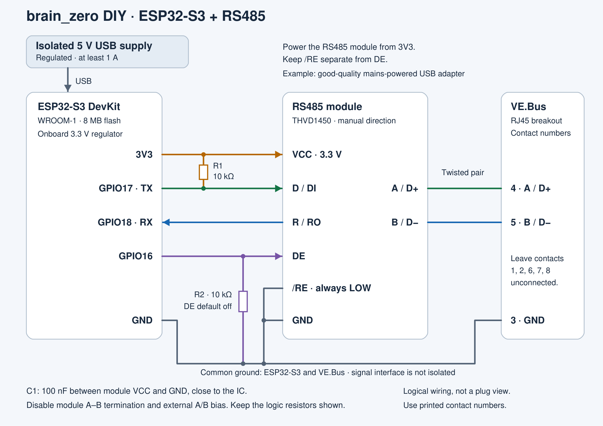

# Build a 5 V brain_zero with an ESP32-S3 development board

Build an externally powered brain_zero using an ESP32-S3-WROOM development board, a manual-direction RS485 module and a numbered RJ45 breakout. Use an **isolated, regulated 5 V supply**, for example a good-quality, safety-approved mains-powered USB adapter. The development board supplies 3.3 V to the RS485 module; only three contacts connect to the inverter's VE.Bus socket.

The wiring below matches Rev C's schematic and current firmware. Third-party development boards and RS485 breakouts vary; check your chosen assembly on the bench before connecting it to the inverter. Inverter support follows the [main compatibility table](../README.md#multiplus-ii-compatibility).

## What you need

| Part | Requirements |
| --- | --- |
| ESP32-S3 development board | A complete DevKitC-1-style board with an ESP32-S3-WROOM-1 module, **8 MB quad-SPI flash**, onboard 3.3 V regulator, native USB, BOOT and RESET buttons, and accessible GPIO16, GPIO17 and GPIO18. The firmware's default PlatformIO target is the N8 configuration; PSRAM is not used. |
| RS485 module | A **THVD1450** breakout operated at **3.3 V**, with separate **D/DI, R/RO, DE, /RE, A and B** connections. This is the transceiver used on Rev C. Choose a board whose bus termination and bias resistors can be disabled. |
| RJ45 breakout and cable | A plain, unmagnetised, numbered 8P8C screw-terminal breakout and a straight-through network cable. |
| Power | An **isolated, regulated 5 V USB supply rated for at least 1 A**, such as a good-quality, safety-approved mains-powered USB adapter. A standalone USB power bank is another option. Use a USB data cable for programming. |
| Small parts | Two 10 kΩ resistors and one 100 nF ceramic capacitor, if the module does not already provide the connections shown below. |
| Assembly tools | Short insulated wires, soldering equipment or secure screw terminals, a multimeter and an insulating enclosure. |

Use an **ESP32-S3** development board. A bare WROOM module needs its own power, reset and programming circuitry, and the original ESP32-WROOM-32 is a different target. For the board's power inputs and header labels, see [Espressif's DevKitC-1 guide](https://docs.espressif.com/projects/esp-dev-kits/en/latest/esp32s3/esp32-s3-devkitc-1/user_guide_v1.1.html).

### Choose the RS485 module carefully

The THVD1450 operates from 3.0–5.5 V, but **power it at 3.3 V in this circuit** so its receiver output matches the ESP32's logic supply. Its independent enables and light receiver loading match the Rev C design. See the [TI datasheet](https://www.ti.com/lit/ds/symlink/thvd1450.pdf).

The module must allow `/RE` and `DE` to be wired separately. Avoid automatic-direction modules and boards that permanently join these two signals. Ordinary 5 V MAX485 modules are unsuitable for the direct GPIO connections in this guide: their receiver output can reach 5 V.

Disable the module's **120 Ω A-to-B termination** and any external **A/B pull-up or pull-down bias resistors**. For this added interface, leave termination and external A/B bias disabled to match Rev C. The DI pull-up and DE pull-down below are on the logic side and stay fitted. Check the module's schematic; resistor designators differ between products.

## Connection diagram



[Open the scalable wiring diagram](images/diy-esp32-s3-wiring.svg). The RJ45 numbers identify electrical contacts, not a view of the plug or socket. Use a numbered breakout and confirm continuity with a multimeter.

| From | To | Purpose |
| --- | --- | --- |
| Isolated 5 V USB supply | Development board's USB power input | Powers the board and its onboard regulator |
| Development board **3V3** | RS485 **VCC** | 3.3 V transceiver supply |
| Development board **GND** | RS485 **GND** and RJ45 **contact 3** | Common signal reference |
| **GPIO17** | RS485 **D / DI** | UART transmit data |
| RS485 **R / RO** | **GPIO18** | UART receive data |
| **GPIO16** | RS485 **DE** | Enables the driver only while sending |
| RS485 **/RE** | **GND** | Keeps the receiver enabled, including during transmission |
| RS485 **DE** | **GND through 10 kΩ** | Holds the driver off during reset |
| RS485 **D / DI** | **3V3 through 10 kΩ** | Holds transmit data at its idle level during reset |
| RS485 **VCC** | **GND through 100 nF** | Local supply decoupling, close to the transceiver |
| RS485 **A**, non-inverting | RJ45 **contact 4** | VE.Bus A / D+ |
| RS485 **B**, inverting | RJ45 **contact 5** | VE.Bus B / D− |

Leave RJ45 contacts **1, 2, 6, 7 and 8 unconnected in this build**. Contact 2 is an inverter supply connection and must not join the USB 5 V rail. Contact 7 is not ground. The contact assignment is also shown on sheet 2 of [Victron's Venus GX schematic](https://github.com/victronenergy/venusgx-hardware/blob/master/VE_BBB_Cape_v0.80_released.pdf).

Use the board's **GPIO numbers**, rather than counting header positions. Pins printed simply **TX** and **RX** on many S3 boards are the separate programming UART, not GPIO17 and GPIO18. Follow the transceiver IC's A/B polarity if a breakout uses different `+`/`−` labels.

Keep the GPIO wiring short and retain the cable's twisted pair for contacts 4 and 5. This is a non-isolated interface: USB ground and VE.Bus contact 3 are connected. **The external 5 V supply must provide galvanic isolation**, for example a good-quality, safety-approved mains-powered USB adapter. Program it on the bench with VE.Bus disconnected, then use the isolated supply or a standalone power bank for operation.

## Assemble and check the circuit

1. Disconnect all power and the VE.Bus cable. Identify the module's IC and disable its bus termination and bias resistors.
2. Make the connections in the table. Keep `/RE` grounded separately from `DE`: brain_zero listens to its own transmitted frames.
3. Fit the two resistors and the 100 nF capacitor if those connections are absent from the module.
4. Check the RJ45 breakout's contacts 3, 4 and 5 against the cable. Check for supply shorts and unintended connections to the unused contacts.
5. Power the development board through USB, with VE.Bus still disconnected. Measure approximately 3.3 V between the module's VCC and GND.

For an external wired 5 V supply, use the development board's **5V** and **GND** inputs instead of USB power. **That supply must also be isolated.** Disconnect it before attaching a computer's USB cable. Never apply 5 V to the board's **3V3** pin or to a GPIO.

## Build and flash brain_zero

DIY hardware uses firmware compiled from this repository. Install [Git](https://git-scm.com/downloads) and [PlatformIO IDE for VS Code](https://docs.platformio.org/en/latest/integration/ide/vscode.html), then open a **PlatformIO Core CLI** terminal. The commands below use Windows PowerShell; use `cp` instead of `Copy-Item` on Linux or macOS.

### Get the source and configure Wi-Fi

```powershell
git clone https://github.com/mjpalmowski/brain_zero.git
cd brain_zero
Copy-Item firmware/vebus_listener/include/wifi_secrets.example.h firmware/vebus_listener/include/wifi_secrets.h
```

Edit `firmware/vebus_listener/include/wifi_secrets.h` with your 2.4 GHz network's SSID and password:

```cpp
#define WIFI_SSID "Your Wi-Fi network"
#define WIFI_PASSWORD "Your Wi-Fi password"
```

Keep this file private. It is ignored by Git, and a build made with it contains your network credentials. Keep the header in place for every future DIY build so the device can reconnect after an update.

### Upload over native USB

1. Leave VE.Bus disconnected. Connect a USB data cable to the development board's **ESP32-S3 native USB** connector, often marked **USB** or **OTG**, rather than its separate USB-to-UART connector.
2. Build the firmware and list the serial devices:

   ```powershell
   pio run -d firmware/vebus_listener -e listener
   pio device list
   ```

3. Replace `COM7` below with your board's port, then upload:

   ```powershell
   pio run -d firmware/vebus_listener -e listener -t upload --upload-port COM7
   ```

   On Linux or macOS, use the port reported by `pio device list`, such as `/dev/ttyACM0` or `/dev/cu.usbmodem...`.

4. If the board does not enter programming mode, hold **BOOT**, tap and release **RESET**, release **BOOT**, then retry the upload. Tap **RESET** afterwards if it stays in the bootloader.

This initial upload installs the bootloader, partition table and application. Uploading the standalone OTA `firmware.bin` alone is not a complete first-time flash.

The default [`listener` build](../firmware/vebus_listener/platformio.ini) targets 8 MB flash and uses **GPIO17 TX, GPIO18 RX, GPIO16 DE, 250000 baud, 8N1**. The firmware configures the bus UART automatically. Boards with different memory or wiring need corresponding changes before building.

## Connect to the web interface

After restart, open [http://brain-zero.local/](http://brain-zero.local/) on the same network. If that name does not resolve, find **brain-zero** in your router's connected-device list and open its IP address.

For optional USB status output:

```powershell
pio device list
pio device monitor --port COM7 --baud 115200
```

The native USB port may change after flashing. Close the monitor before the next upload. The separate USB-to-UART port carries a different debug stream at 921600 baud.

## Connect to the inverter

1. Disconnect the programming computer. Power the device from its **isolated 5 V USB supply**, then use the straight-through cable to connect the breakout to the inverter's **VE.Bus** socket. The similar-looking Ethernet, VE.Can and battery BMS sockets are different interfaces.
2. Leave **Run ESS from this ESP32** off during the first checks. Open **System → Diagnostics** and verify that inverter frames arrive, the detected model and firmware are correct, and the live voltage readings match your system.
3. Before enabling ESS, check the [supported model and firmware list](../README.md#multiplus-ii-compatibility) and make this device the sole controller for the standalone inverter. Remove the previous GX/MK3 controller from that VE.Bus connection when handing over control.
4. Configure ESS deliberately in the web interface, then check acknowledgements and the resulting operating state in Diagnostics. For an unsupported inverter/firmware combination, use **System → Inverter settings → Submit to developer**.

The [esp32ess project](https://github.com/pv-baxi/esp32ess) is another useful DIY hardware reference. Use the brain_zero connections above for this firmware: in particular, its receiver-enable wiring and baud rate are different.

## Future updates

Pull the latest source, keep your private Wi-Fi header, and build again:

```powershell
git pull --ff-only
pio run -d firmware/vebus_listener -e listener
```

For Wi-Fi updates, select **System → Firmware update → Upload a build** and upload your newly compiled `firmware/vebus_listener/.pio/build/listener/firmware.bin`. Select **Upload and verify**, then **Install and restart**. Check the device before selecting **Keep this build**.

GitHub Release binaries are published for brain_zero boards. Continue compiling your own image for this DIY device, with its board configuration and Wi-Fi header.

## Troubleshooting

| Symptom | Check |
| --- | --- |
| No USB port | Use a data cable and the native USB connector; enter BOOT/RESET programming mode and list devices again. |
| No web page | Check the SSID/password, 2.4 GHz coverage, the router's IP list and whether the Wi-Fi header was present for this build. |
| No inverter frames | Verify RJ45 contacts 3/4/5, common ground, module VCC at 3.3 V, A/B polarity and `/RE` at GND. |
| Receives frames but cannot send reliably | Verify GPIO17→DI and GPIO16→DE, independent `/RE`, the DE pull-down, and removal of module termination/bus bias. An automatic-direction module is unsuitable. |
| Control waits for another master | Remove the previous GX/MK3 controller when handing over ESS control. |
| Resets during Wi-Fi activity | Check the 5 V supply, USB cable, 3.3 V rail and local transceiver decoupling. |

Secure the finished circuit in an insulating enclosure with strain relief and clearance around the WROOM antenna.
